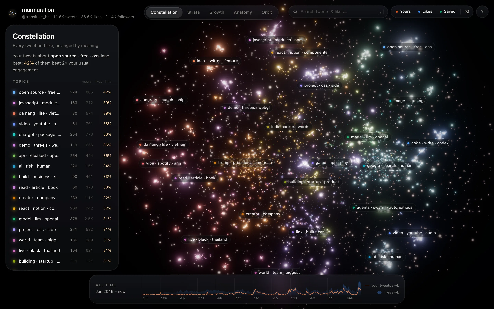
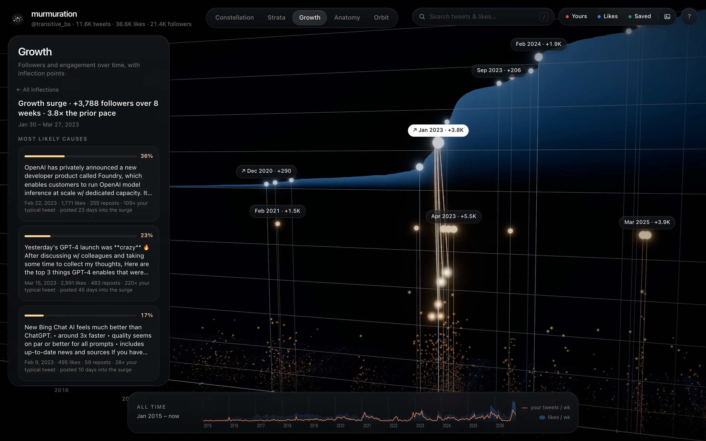
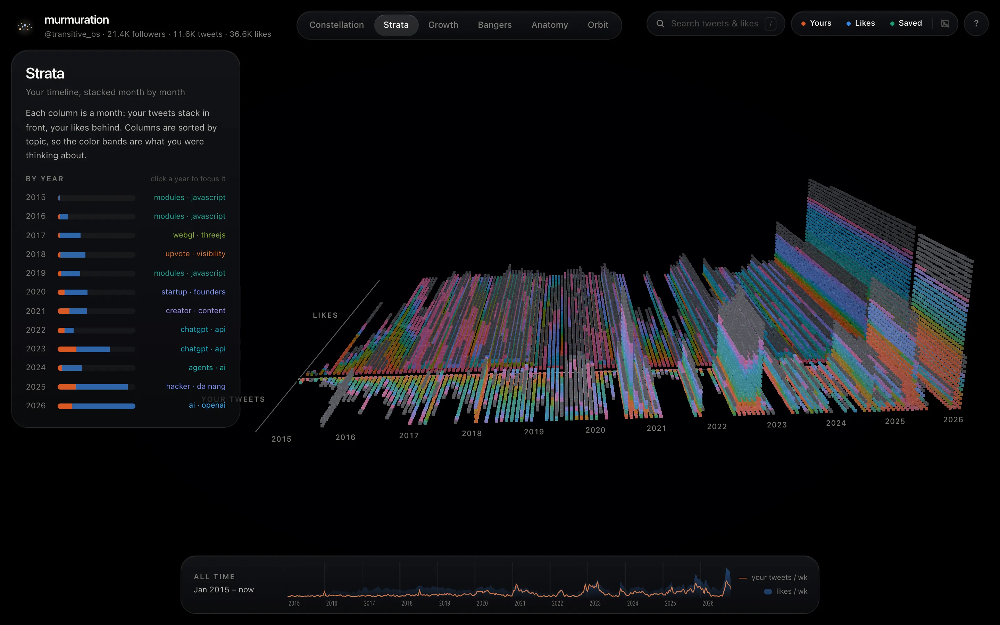
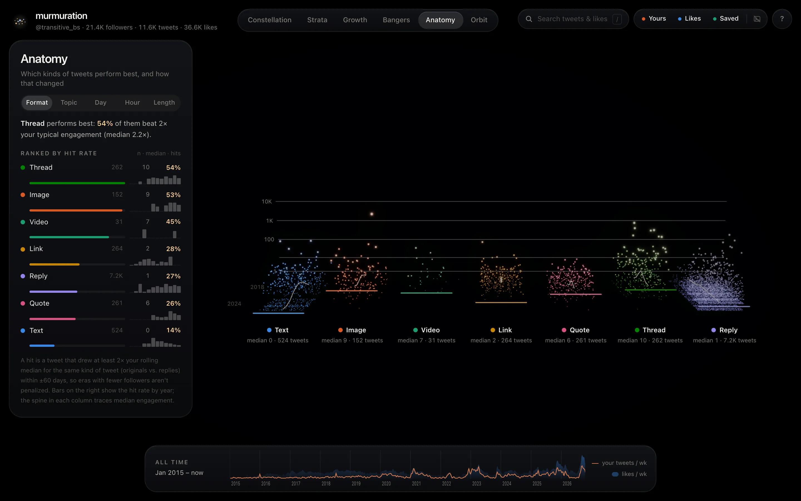
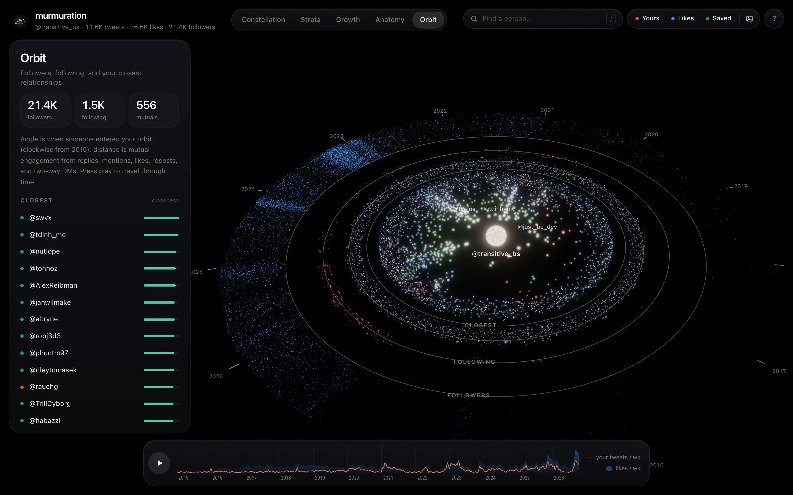

# murmuration

> A quiet 3D observatory for everything you've posted and loved on X.



Murmuration turns your local [Birdclaw](https://birdclaw.sh) archive into a field of ~50k particles that flock between six views. It shows what you talk about, what lands, how your audience grew, why it grew when it did, and who you're closest to. Everything runs locally and reads your archive strictly read-only.

<p>
  
  
</p>
<p>
  
  
</p>

- **Constellation:** every tweet and like placed by meaning, with labeled topic nebulae and the topics where your tweets land best.
- **Growth:** your follower curve, reconstructed from the archive, above every tweet's engagement. Click an inflection point to see the tweets most likely to have caused it, or a flag that the boost came from somewhere else.
- **Bangers:** your biggest hits and outliers on a timeline, each one a click away.
- **Strata:** your timeline stacked month by month, with topic-colored layers for what you were thinking about each year.
- **Anatomy:** which kinds of tweets hit (format, topic, day, hour, length) and how that changed year by year.
- **Orbit:** followers, following, and the people you actually talk with, by two-way engagement. Press play to watch your audience accrete over time.

## Get started

Requires Node 24+, pnpm, and a Birdclaw archive (`birdclaw import archive <your-x-archive.zip>`).

```bash
pnpm install && pnpm dev
```

Optionally, put an `OPENAI_API_KEY` in `.env` for better topics with image understanding (computed once per tweet). To publish a static snapshot with DM text stripped, run `pnpm export && pnpm build`.

Or hand it to an agent:

```text
Clone https://github.com/transitive-bullshit/murmuration, run `pnpm install && pnpm dev`, and open the URL it prints. It reads ~/.birdclaw/birdclaw.sqlite read-only; if that file is missing, help me import my X archive with Birdclaw first.
```

## License

MIT © [Travis Fischer](https://x.com/transitive_bs)

---

Want to change it or see where everything lives? See [contributing.md](contributing.md).
